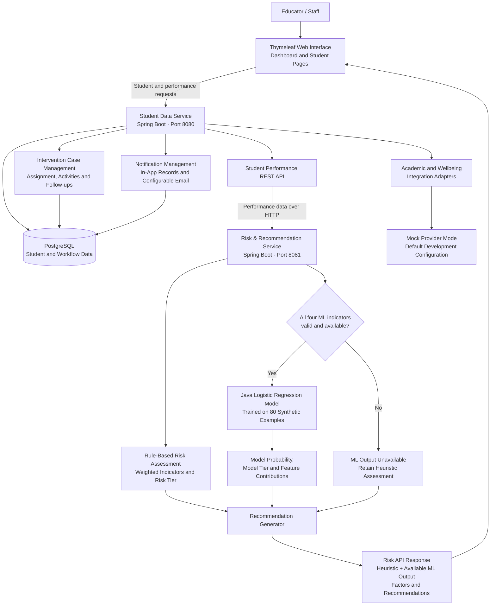
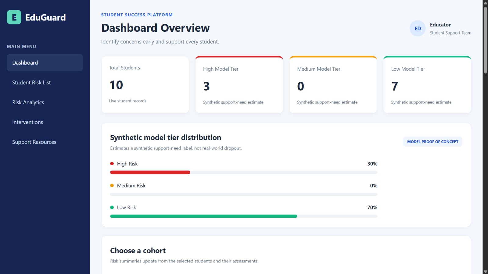
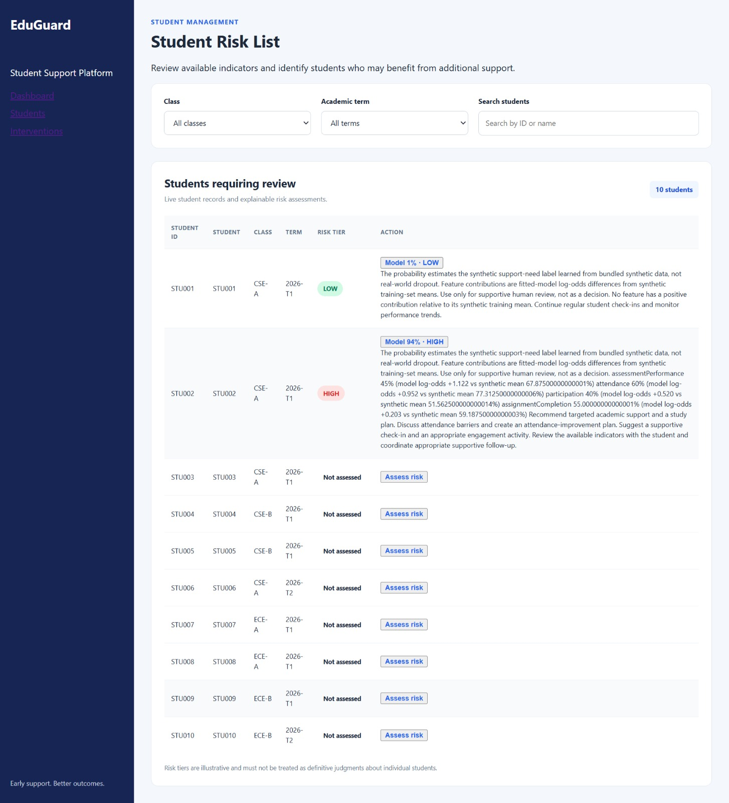

# EduGuard 💚

### Every student who drops out has a story. What if we could understand that story before it's too late?

A decline in attendance, falling grades, or reduced participation can sometimes signal that a student needs help. But what if educators could recognise those warning signs earlier, understand what might be contributing to them, and offer support before a student gives up?

**EduGuard is a student dropout risk assessment and intervention management platform developed for SustainAI2026 — Hackathon on “GreenOps: Enterprise AI using Spring Boot & Microservices.”**

Our platform brings student information and performance indicators together, provides explainable risk assessments, suggests supportive interventions, and helps staff coordinate follow-ups.

Our goal isn't to label students as risks. **It's to recognise when they might be at risk of being left behind.**

---

## 🌱 1. The Problem

Educational institutions may notice student disengagement only after attendance or academic performance has declined significantly. Relevant information can be scattered across attendance records, assessment results, and engagement data, making it difficult to identify students who may need timely support.

EduGuard aims to bridge this gap by helping educators:

* Identify students who may need additional attention.
* Understand the indicators contributing to a risk assessment.
* Explore suitable academic, wellbeing, or financial-support options.
* Coordinate interventions and track follow-ups.
* Bring available student information into a unified view.

The focus is on **early support, informed decisions, and student wellbeing**—not punishment or automated decisions about a student's future.

## 💡 2. Our Solution

EduGuard combines student data management, risk assessment, a logistic regression proof of concept, supportive recommendations, intervention case management, and notifications.

The application has two Spring Boot microservices:

* **Student Data Service:** Manages student information, performance data, the web interface, and supporting workflows.
* **Risk & Recommendation Service:** Calculates the original heuristic assessment, runs the logistic regression model when valid data is available, and returns explanations and recommendations.

The services communicate through REST APIs, and PostgreSQL provides persistent storage for the application.

### Key Features

* **Student profiles:** Retrieve student records and available performance indicators.
* **Risk assessment:** Combine rule-based scoring with an additional ML prediction.
* **Explainable results:** Display contributing factors for staff review.
* **Support recommendations:** Suggest mentoring, remedial support, counselling referral, or financial-support eligibility checks where appropriate.
* **Intervention management:** Create, assign, update, and close cases, with activity and follow-up tracking.
* **Notifications:** Manage notification records and in-app read tracking; email handling depends on configuration.
* **External integration support:** Academic and wellbeing adapters support configured integration modes, with mock mode available for development.

---

## 🧩 3. How EduGuard Works

1. The application retrieves a student's available academic and engagement indicators.
2. The Risk & Recommendation Service calculates the existing heuristic risk score and tier.
3. If all four required indicators are valid, the logistic regression model produces an additional prediction.
4. The service returns the heuristic assessment, available ML output, contributing factors, and recommendations.
5. The dashboard and student page display the results for review.
6. Staff can use the intervention workflow to coordinate support and track follow-ups.

**Our workflow:**

`Student Data → Risk Assessment → Explanation → Suggested Support → Intervention Follow-up`

## 🏗️ 4. System Architecture

The following Mermaid diagram represents the implemented application flow, including the frontend, both microservices, PostgreSQL, the model, recommendations, notifications, and external integration adapters.



### Architecture notes

* The Student Data Service owns application data access.
* The Risk & Recommendation Service retrieves performance data through REST; it does not directly query the Student Data Service's database.
* The original heuristic assessment remains available when ML inference cannot run.
* Logistic regression is implemented inside the Risk & Recommendation Service; it is not a separate ML microservice.
* Academic and wellbeing integrations have mock-mode support. The diagram does not imply that live external providers are connected.
* The diagram describes the intended application flow. Actual availability depends on correct database configuration, service URLs, and runtime configuration.

---

## 🤖 5. AI/ML: Explainable Logistic Regression

EduGuard integrates a Java logistic regression model into its existing Risk & Recommendation Service. It adds a learned prediction and feature-based explanations without removing the original rule-based assessment.

### Existing rule-based assessment

The original heuristic assessment considers four indicators:

* Attendance
* Assessment performance
* Participation
* Assignment completion

It calculates a weighted score, assigns a risk tier, and identifies contributing factors.

### Logistic regression model

**Implementation:** `LogisticRegressionRiskModel.java`

**Training data:** `risk-recommendation-service/src/main/resources/ml/risk-training-data.csv`

The model:

* Uses four performance indicators as input features.
* Trains on 80 synthetic examples.
* Uses gradient descent to fit the logistic regression coefficients.
* Estimates the probability of a synthetic support-need label.
* Assigns a separate model risk tier.
* Calculates feature contributions to help explain its output.

The model is trained in Java when the Risk Service initializes. It does not require a separate ML service or external AI API to produce its prediction.

### What does the model learn?

The dataset contains a target label named `synthetic_support_need`. A row receives label `1` when at least two indicators fall below the following thresholds:

| Indicator              | Threshold |
| ---------------------- | --------: |
| Attendance             | Below 75% |
| Assessment performance | Below 60% |
| Participation          | Below 40% |
| Assignment completion  | Below 50% |

Otherwise, the row receives label `0`.

**Important:** These labels are generated from predefined thresholds. They are not based on observed student dropout outcomes.

### Understanding the output

The API preserves the original heuristic fields:

* `riskScore`
* `riskTier`
* `indicators`
* `contributingFactors`
* `recommendedInterventions`

It adds these ML-related fields:

* `riskModel`
* `modelOutcome`
* `modelProbability`
* `modelRiskTier`
* `modelContributingFactors`
* `modelNote`

The heuristic tier and model tier are separate assessments. Model feature contributions are calculated from the fitted coefficients and the student's feature values relative to training-data means.

These explanations describe how the model contributes to its prediction; they do not establish causation.

### Handling missing data

The model runs only when all four required indicators are available and valid. If data is missing or invalid, the ML result is marked unavailable while the original heuristic assessment remains available.

### Responsible AI

The model's probability is **not a validated real-world dropout probability**. Its real-world predictive accuracy, calibration, and fairness have not been established. EduGuard is a proof of concept intended to support human review, not replace educators' judgement or make consequential decisions automatically.

---

## 📋 6. SustainAI2026 Problem Statement Coverage

The following table maps the hackathon's student-support and enterprise application requirements to EduGuard's implementation and identifies areas that require further development or verification.

| Requirement                             | EduGuard implementation and status                                                                                                                                              |
| --------------------------------------- | ------------------------------------------------------------------------------------------------------------------------------------------------------------------------------- |
| Student profile management              | Student records and available performance data are retrieved through the Student Data Service.                                                                                  |
| Attendance and grade history            | Attendance and assessment indicators are used in the student performance view and risk assessment.                                                                              |
| Unified data integration                | Available attendance, assessment, and engagement indicators are combined through the performance API.                                                                           |
| Socio-economic/support signals          | Support-request workflows and financial-support eligibility checks support student assistance. The platform should not be assumed to contain a complete socio-economic dataset. |
| Dropout risk prediction                 | Rule-based risk scoring and a separate logistic regression prediction of a synthetic support-need label. Actual dropout prediction has not been validated.                      |
| Risk tiers                              | The heuristic and ML model provide separate risk tiers.                                                                                                                         |
| Risk-factor explanation                 | Heuristic contributing factors and model-specific feature contributions are returned for review.                                                                                |
| Intervention recommendations            | The recommendation generator suggests supportive actions using available assessment information.                                                                                |
| Mentoring and remedial support          | Supported as recommendation categories where implemented by the recommendation logic.                                                                                           |
| Counselling referral                    | Supported as a possible recommendation category; real-world referral workflows depend on institutional procedures.                                                              |
| Scholarship or financial support        | Financial-support request workflows and eligibility checks support follow-up. They do not guarantee funding or eligibility.                                                     |
| Case management                         | Supports intervention case creation, assignment, updates, activities, and follow-up tracking.                                                                                   |
| Cohort and early-trend analytics        | Student listing and available filters support browsing. Advanced cohort, class, subject, and longitudinal trend analytics require further verification or development.          |
| Outcome and effectiveness dashboard     | Intervention records support tracking, but retention improvement or intervention effectiveness has not been demonstrated.                                                       |
| Similar past cases                      | Case records can support future development of case-based suggestions. Automated similarity-based recommendations should not be claimed unless verified in the implementation.  |
| Web interface                           | Thymeleaf dashboard and student pages display student information, risk output, explanations, and recommendations.                                                              |
| Spring Boot REST APIs                   | Both services expose REST APIs.                                                                                                                                                 |
| Minimum two microservices               | Student Data Service and Risk & Recommendation Service.                                                                                                                         |
| Inter-service REST communication        | The Risk Service calls the Student Data Service to retrieve performance data.                                                                                                   |
| Database integration                    | PostgreSQL, Spring Data JPA, and Hibernate support persistent application data.                                                                                                 |
| Meaningful AI/ML                        | Java logistic regression, synthetic training examples, model probability, model tier, and feature contributions.                                                                |
| End-to-end student-support flow         | Student performance retrieval, risk assessment, recommendations, and intervention management are connected. The complete workflow must be verified in the target environment.   |
| Anonymised or simulated data            | The ML training dataset is synthetic. Demonstrations should use anonymised or simulated student records.                                                                        |
| Explainable, non-discriminatory outputs | Contributing factors are provided for review. However, fairness has not been validated; further bias evaluation is required before real-world deployment.                       |

EduGuard implements the core student risk-assessment and intervention workflow. Advanced analytics, real-world predictive validation, and intervention-effectiveness measurement remain important opportunities for improvement.

---
## 🖥️ 7. Application Screenshots

EduGuard provides a dashboard for monitoring student risk assessments and a
student risk list that helps educators review individual students, understand
their assessment results, and identify potential support needs.

### Dashboard Overview

The dashboard displays the total number of students and the distribution
of model risk tiers, helping educators understand the current synthetic
support-need estimates across the available student records.



### Student Risk List and Recommendations

The Student Risk List displays individual student records, their available
risk tiers, and model predictions when the required performance data is
available. Educators can review the model probability, contributing factors,
and suggested supportive actions.

Students without sufficient assessment data are displayed as **Not assessed**.



> **Note:** The logistic regression model is a proof of concept trained on
> synthetic support-need labels. Its probabilities are not validated real-world
> dropout probabilities. Assessments are intended to support human review,
> not automated decisions about students.
---

## 🛠️ 8. Technology Stack

| Component            | Technology                              |
| -------------------- | --------------------------------------- |
| Programming language | Java 21                                 |
| Backend framework    | Spring Boot                             |
| Architecture         | Two microservices                       |
| Communication        | REST APIs / HTTP                        |
| Database             | PostgreSQL                              |
| Persistence          | Spring Data JPA and Hibernate           |
| Frontend             | Thymeleaf, HTML, CSS, JavaScript        |
| Machine learning     | Java logistic regression                |
| Training algorithm   | Gradient descent                        |
| Explainability       | Coefficient-based feature contributions |
| Testing              | JUnit and Spring testing support        |
| Build                | Maven Wrapper                           |

---

## 🚀 9. Running EduGuard Locally

### Prerequisites

* JDK 21
* PostgreSQL
* Git
* PowerShell on Windows

### Step 1: Clone the repository

```powershell
git clone https://github.com/krithikashree1957/EduGuard.git
Set-Location "EduGuard"
```

### Step 2: Prepare PostgreSQL

1. Create a database named `eduguard_db`.
2. Review and execute `database/eduguard_setup.sql`.
3. Review and apply the required SQL migration files in order.
4. Configure the database username and password through environment variables.
5. Ensure that the schema matches the application's JPA entity mappings.

The Student Data Service uses configuration similar to:

```properties
spring.datasource.url=jdbc:postgresql://localhost:5432/eduguard_db
spring.datasource.username=postgres
spring.datasource.password=${DB_PASSWORD}
spring.jpa.hibernate.ddl-auto=validate
```

Set `DB_PASSWORD` in your local environment. Never commit real credentials to Git.

The current configuration does not automatically apply migrations through Flyway or Liquibase, so the database setup scripts must be applied manually.

The Student Data Service context smoke test uses an isolated in-memory H2 database, so
`mvnw test` does not require the local PostgreSQL password. Production and manual
integration runs continue to use the PostgreSQL configuration above.

### Step 3: Start the Student Data Service

```powershell
Set-Location "D:\Eduguard\eduguard"
.\mvnw.cmd spring-boot:run
```

Default port: `8080`.

### Step 4: Start the Risk & Recommendation Service

Open a second PowerShell window:

```powershell
Set-Location "D:\Eduguard\risk-recommendation-service"
.\mvnw.cmd spring-boot:run
```

Default port: `8081`.

Ensure the Risk Service points to the correct Student Data Service URL and that the database is available.

### Step 5: Open the application

* Dashboard: `http://localhost:8080/`
* Student page: `http://localhost:8080/students`

Example API endpoints:

```text
GET http://localhost:8080/api/students
GET http://localhost:8080/api/students/{studentId}/performance
GET http://localhost:8081/api/risk/students/{studentId}
```

Replace `{studentId}` with an ID returned by the student-list API. Refer to the current controllers for the exact supported routes.

---

## 🧪 10. Testing

Run the Student Data Service tests:

```powershell
Set-Location "D:\Eduguard\eduguard"
.\mvnw.cmd test
```

Run the Risk & Recommendation Service tests:

```powershell
Set-Location "D:\Eduguard\risk-recommendation-service"
.\mvnw.cmd test
```

Key risk-service test classes include:

* `LogisticRegressionRiskModelTest` — training, probability bounds, tier assignment, feature contributions, and validation.
* `RiskAssessmentControllerTest` — controller behavior and heuristic fallback.
* `RecommendationGeneratorTest` — recommendation behavior with ML integration.
* `RiskAssessmentHttpIntegrationTest` — HTTP risk behavior and preservation of response fields.
* `StudentPerformanceClientTest` — performance retrieval client behavior.

**Previously observed test result:** A Student Data Service test run reported 42 tests, zero assertion failures, and one error in `EduguardApplicationTests.contextLoads`. Hibernate could not obtain JDBC metadata to determine the database dialect. That run did not pass completely.

Rerun both suites after resolving the test database/configuration issue. Report only the latest verified results when presenting the project as fully tested.

---

## 🔒 11. Privacy, Security, and Limitations

* Use anonymised or simulated student data for demonstrations.
* The training dataset is synthetic, and its labels are threshold-derived.
* The ML probability is not a validated real-world dropout probability.
* Real-world accuracy, calibration, and fairness have not been established.
* Feature contributions are explanatory model outputs, not proof of causation.
* Human review is essential before any intervention or support decision.
* Intervention tracking does not prove that retention has improved.
* Real student records require appropriate privacy safeguards, authentication, authorization, and record-level access controls.
* Mock integration mode does not establish that a real external provider was contacted or that an email was delivered.
* Database migrations must be applied correctly before running the application.

EduGuard must not be used as the sole basis for decisions affecting a student's education, financial assistance, or access to services.

---

## 🌟 12. Future Enhancements

* Add and verify authentication, staff roles, and record-level authorization.
* Improve privacy controls, audit trails, and data governance.
* Evaluate the model using appropriate, ethically sourced, representative data.
* Measure predictive performance, calibration, and fairness.
* Develop cohort and early-trend analytics.
* Measure intervention effectiveness using suitable outcome data.
* Expand automated end-to-end testing.
* Configure and verify real academic and wellbeing integrations.
* Improve monitoring, resilience, and scalability.

---

## 👥 Team EduGuard

**Created for SustainAI2026 — Hackathon on “GreenOps: Enterprise AI using Spring Boot & Microservices.”**

We built EduGuard to explore how enterprise application architecture and explainable AI can help educators recognise potential student-support needs and coordinate timely interventions.

### Team Members

1. **Krithika Shree.K** — [GitHub](https://github.com/krithikashree1957)
2. **Venikalaxmi.S** — [GitHub](https://github.com/venikalaxmisaravanan)
3. **Nirmal Priya.S** — [GitHub](https://github.com/Nirmal-Priya)

---

## 💚 Our Vision

Every student deserves the opportunity to be heard before they decide to leave.

EduGuard brings student indicators, explainable assessments, and support workflows together to help educators recognise potential concerns and coordinate timely assistance.

**Because behind every warning sign, there is a student—and behind every student, there is a story worth listening to.**
